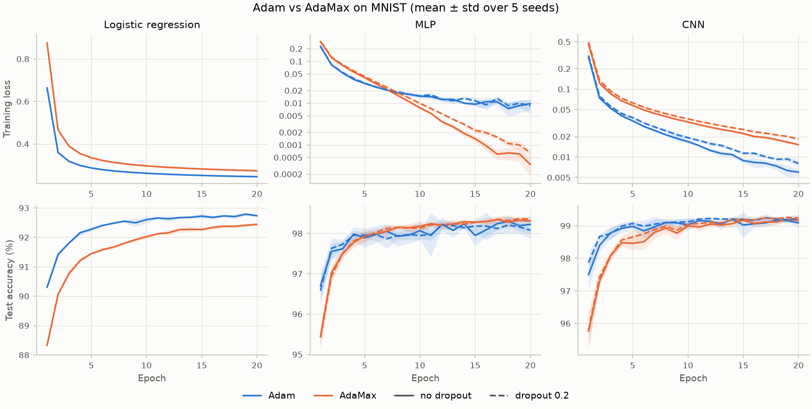
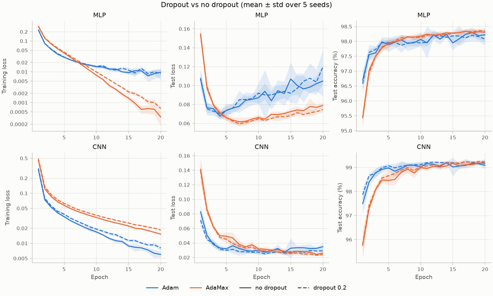

# Adam and AdaMax on MNIST

[](https://github.com/michaelperez023/ADAM/actions/workflows/ci.yml)

Adam and AdaMax implemented in PyTorch from Algorithms 1 and 2 of Kingma & Ba (2015), and
compared on MNIST with three models: multinomial logistic regression, a fully connected
network (MLP) and a small convolutional network (CNN), the last two with and without
dropout.

This was my term project for CAP 6617 at the University of Florida (fall 2022, Dr. Kejun
Huang). The [original notebook][notebook-2022] is in the git history. Its saved outputs
are from a complete run, but the CNN + AdaMax cell was edited afterwards, merging two
lines into one, so rerunning the notebook stops there with a syntax error. This version
turns it into a tested Python package, fixes several bugs in the 2022 experiments and
reruns every configuration with five seeds.

[notebook-2022]: https://github.com/michaelperez023/ADAM/blob/3fa3cb6b8a9a80c08bc7086cff40882b92a309ff/code.ipynb

## Results



Final test accuracy (%) after 20 epochs, mean ± standard deviation over five seeds. The
last column is the per-seed difference between the two optimizers.

| Model | Dropout | Adam | AdaMax | Adam - AdaMax |
|---|---|---|---|---|
| Logistic regression | none | 92.73 ± 0.04 | 92.44 ± 0.04 | +0.29 ± 0.06 |
| MLP | none | 98.22 ± 0.22 | 98.31 ± 0.03 | -0.08 ± 0.23 |
| MLP | 0.2 | 98.08 ± 0.20 | 98.35 ± 0.05 | -0.27 ± 0.19 |
| CNN | none | 99.09 ± 0.15 | 99.17 ± 0.08 | -0.08 ± 0.18 |
| CNN | 0.2 | 99.23 ± 0.10 | 99.23 ± 0.11 | 0.00 ± 0.09 |

With the same constant step size of 0.001 for both optimizers:

- **Logistic regression.** Adam converges faster. In every seed it ends with a lower
  training loss and a higher test accuracy than AdaMax, by 0.29 points on average.
- **MLP.** AdaMax keeps reducing the training loss, to 0.0003 without dropout, while
  Adam's decreases only slowly after about ten epochs and fluctuates around 0.01. Adam's
  final test accuracy also varies more between seeds (standard deviation 0.22 against 0.03
  without dropout). With dropout, AdaMax is ahead in all five seeds.
- **CNN.** Adam reaches the lower training loss and AdaMax the lower test loss; the test
  accuracies agree within one standard deviation.
- **Dropout** (p = 0.2) changes the final test accuracy by at most 0.14 points on average,
  for either network and optimizer, which is less than the standard deviation of that
  change across seeds.



The training loss of the dropout runs is measured with dropout active, as it is during
training, so it is not directly comparable with the training loss of the runs without
dropout. The test loss and accuracy are always measured with dropout off.

The MLP's test loss is lowest after four epochs with Adam and seven with AdaMax. After
that it rises while the test accuracy still improves slightly: the network keeps fitting
the training set and becomes more confident, including on the test images it
misclassifies.

The other figures are in [results/figures](results/figures).
[results/summary.csv](results/summary.csv) lists the final training and test losses, and
[results/results.json](results/results.json) holds the per-epoch metrics of every run. The
runs used PyTorch 2.15.0 on the CPU.

## Adam and AdaMax

Adam keeps exponential moving averages of the gradient $g_t$ and of its elementwise
square, and scales each parameter's step by the ratio of the first average to the square
root of the second:

```math
\begin{aligned}
m_t &= \beta_1 m_{t-1} + (1 - \beta_1)\, g_t \\
v_t &= \beta_2 v_{t-1} + (1 - \beta_2)\, g_t^2 \\
\hat m_t &= \frac{m_t}{1 - \beta_1^t}, \qquad \hat v_t = \frac{v_t}{1 - \beta_2^t} \\
\theta_t &= \theta_{t-1} - \alpha\, \frac{\hat m_t}{\sqrt{\hat v_t} + \epsilon}
\end{aligned}
```

Both averages start at zero, so they are biased towards zero during the first updates;
dividing by $1 - \beta^t$ removes that bias. The method combines the per-parameter step
sizes of AdaGrad (Duchi et al., 2011), which suit sparse gradients, with the moving
average of squared gradients from RMSProp (Tieleman & Hinton, 2012), which suits
non-stationary objectives. Unlike RMSProp with momentum (Graves, 2013), Adam applies
momentum to the gradient itself rather than to the rescaled update, and it corrects the
bias of both averages.

AdaMax replaces the second moment with an exponentially weighted infinity norm. The
maximum is not biased towards zero, so only $m_t$ needs a correction:

```math
\begin{aligned}
u_t &= \max(\beta_2\, u_{t-1},\ |g_t|) \\
\theta_t &= \theta_{t-1} - \frac{\alpha}{1 - \beta_1^t}\, \frac{m_t}{u_t}
\end{aligned}
```

[`adam_study/optim.py`](adam_study/optim.py) implements both as `torch.optim.Optimizer`
subclasses. Details the paper leaves open follow `torch.optim.Adam` and
`torch.optim.Adamax`: AdaMax adds $\epsilon$ to $|g_t|$ inside the maximum, and
`weight_decay` adds an L2 term to the gradient. The tests check that both optimizers match
PyTorch's to within 1e-12 in float64 over 500 random steps, with and without weight
decay, and that they work with `state_dict()`/`load_state_dict()` and
`torch.optim.lr_scheduler`.

## Experiments

| Setting | Value |
|---|---|
| Data | MNIST: 60,000 training and 10,000 test images, pixel values scaled to [0, 1] |
| Logistic regression | 784 -> 10 |
| MLP | 784-1000-1000-10, ReLU |
| CNN | two stages of 5x5 convolution, 3x3 max-pooling with stride 2 and ReLU (10 and 50 channels), then a 200-unit ReLU layer and the output layer |
| Dropout | none, or p = 0.2 before the output layer of the MLP and the CNN |
| Optimizers | Adam and AdaMax with beta1 = 0.9, beta2 = 0.999, eps = 1e-8 |
| Step size | 1e-3 for both optimizers, constant |
| L2 penalty | none |
| Training | batch size 128, 20 epochs (9,380 updates), cross-entropy loss |
| Seeds | 0-4 for each of the 10 configurations |
| Recorded per epoch | mean training loss (dropout active), test loss and test accuracy (dropout off) |

Runs with the same seed start from the same initial weights and see the same minibatches
and dropout masks, so at a given seed the two optimizers differ only in their updates.

The models and hyperparameters are the ones the 2022 runs used. Both optimizers share one
step size; the paper suggests 0.002 for AdaMax, and no hyperparameters were tuned.

## Usage

Python 3.10 or newer. On an Intel Mac the newest PyTorch is 2.2.2, which needs Python 3.12
or older.

```bash
git clone https://github.com/michaelperez023/ADAM.git
cd ADAM
python -m venv .venv
source .venv/bin/activate
pip install -e ".[dev]"
pytest
```

The tests use small synthetic datasets, so they do not download MNIST.

On a Linux machine without a GPU, running
`pip install torch torchvision --index-url https://download.pytorch.org/whl/cpu` first
avoids downloading the CUDA libraries.

Run the full grid (10 configurations, 5 seeds, 20 epochs). MNIST is downloaded to
`./data` on first use, and training uses a CUDA GPU when one is available:

```bash
python -m adam_study.experiments --seeds 5 --epochs 20 --out results
```

The script saves `results/results.json` after every run and skips runs that are already
in it, so it can be stopped and restarted. It also writes `summary.csv`, `summary.md` and
the figures in `results/figures`. Other examples:

```bash
# One model and one optimizer, one seed
python -m adam_study.experiments --models cnn --optimizers adamax --seeds 1 --out results-cnn

# The paper's alpha / sqrt(t) step-size decay and an L2 penalty, on logistic regression as
# in the paper's MNIST experiment. By the last of the 9,380 updates the decay has shrunk
# the step size to about alpha / 97, so it needs a larger alpha than the default 1e-3.
python -m adam_study.experiments --models logreg --schedule inv_sqrt --lr 1e-2 --weight-decay 1e-4 --out results-decay

# Redraw the summaries and figures without training
python -m adam_study.experiments --plots-only --out results
```

`python -m adam_study.experiments --help` lists every option.

The 2022 code tested the dropout models with dropout still active. To measure what that
changed, the next command retrains every dropout run in `results/results.json` with the
same settings and seed, and tests each final model with dropout off and with dropout on
(20 passes over the test set, each with new dropout masks). With the same hardware,
PyTorch build and number of threads, the retrained models are the ones from the grid, so
the accuracies with dropout off match `results.json`. The command writes
`results/dropout_eval.json` and `results/dropout_eval.md` and, like the grid, skips runs
that are already saved:

```bash
python -m adam_study.dropout_eval --out results
```

The optimizers can also be used on their own:

```python
from adam_study import Adam, AdaMax

optimizer = AdaMax(model.parameters(), lr=2e-3)
```

The notebook [`notebooks/adam_vs_adamax.ipynb`](notebooks/adam_vs_adamax.ipynb) walks
through the algorithms and the results. It reads `results/results.json` and
`results/dropout_eval.json` and does not train anything:

```bash
pip install -e ".[notebook]"
jupyter nbconvert --to notebook --execute --inplace notebooks/adam_vs_adamax.ipynb
```

## Repository layout

```text
adam_study/
  optim.py         Adam and AdaMax
  models.py        logistic regression, MLP and CNN
  data.py          MNIST as tensors and a minibatch loader with seeded shuffling
  train.py         training and evaluation loop, seeding, step-size schedules
  experiments.py   command-line entry point for the experiment grid
  dropout_eval.py  retrains the dropout runs and tests them with dropout off and on
  plots.py         figures
tests/             optimizer equivalence with torch.optim, models, data, training, CLIs
notebooks/         walkthrough of the algorithms and results
results/           results of the full grid and of the dropout test, summary tables, figures
docs/              course proposal and final presentation
```

## Course documents

[docs/proposal.pdf](docs/proposal.pdf) and [docs/slides.pdf](docs/slides.pdf) are the
original course proposal (October 2022) and final presentation (December 2022). The
proposal uses the ICML LaTeX template, so it carries that template's conference footer; it
was a course document, not a conference submission. The slides describe the 2022 code:
each accuracy in them comes from one unseeded run, which is not enough to rank the two
optimizers reliably, and the dropout models were tested with dropout still active. In
their loss plots, each point is the loss of the last minibatch of an epoch, and where two
curves are compared, the second is shifted one epoch to the left. The proposal describes
the planned experiments, which differ from the ones under [Experiments](#experiments).

Slides 3 and 4 show Algorithms 1 and 2 of Kingma & Ba (2015) as restated in the proposal.
The MNIST samples on slide 6 are a scaled-down copy of
[MnistExamples.png](https://commons.wikimedia.org/wiki/File:MnistExamples.png) by Josef
Steppan, [CC BY-SA 4.0](https://creativecommons.org/licenses/by-sa/4.0/), via Wikimedia
Commons.

## References

- D. P. Kingma and J. Ba. Adam: A Method for Stochastic Optimization. ICLR 2015.
  [arXiv:1412.6980](https://arxiv.org/abs/1412.6980)
- J. Duchi, E. Hazan and Y. Singer. Adaptive Subgradient Methods for Online Learning and
  Stochastic Optimization. JMLR 12:2121-2159, 2011.
  [jmlr.org/papers/v12/duchi11a.html](https://jmlr.org/papers/v12/duchi11a.html)
- T. Tieleman and G. Hinton. Lecture 6.5, RMSProp: Divide the gradient by a running
  average of its recent magnitude. COURSERA: Neural Networks for Machine Learning, 2012.
- A. Graves. Generating Sequences With Recurrent Neural Networks. 2013.
  [arXiv:1308.0850](https://arxiv.org/abs/1308.0850)
- G. E. Hinton, N. Srivastava, A. Krizhevsky, I. Sutskever and R. R. Salakhutdinov.
  Improving neural networks by preventing co-adaptation of feature detectors. 2012.
  [arXiv:1207.0580](https://arxiv.org/abs/1207.0580)
- Y. LeCun, L. Bottou, Y. Bengio and P. Haffner. Gradient-based learning applied to
  document recognition. Proceedings of the IEEE 86(11):2278-2324, 1998.

## License

MIT, see [LICENSE](LICENSE). The optimizer code follows PyTorch's implementation, which is
BSD-3-Clause licensed, and the slides contain third-party material; see
[THIRD_PARTY_NOTICES.md](THIRD_PARTY_NOTICES.md).
